# Git 與 GitHub 版本控制工具入門 — 課堂實作

輔仁大學 企業管理學系 大四 · Chris Yang

依照講義《Git 與 GitHub 版本控制工具入門（2026）》完成全部實作步驟。講義用的是 SourceTree，這裡改用 git 指令完成相同操作。

## 成果

`index.html` 目前內容：

```html
<h1>I love git.</h1>

```

Commit 歷程：

```
* aa4cd0a 修改標題為 I love git.      ← 在「家裡」clone 後修改並 push
* d29b3f9 新增 git logo 圖片
* fa4b0e4 修改標題為 Hello World!!!
* a9e0cf7 新增 index.html
```

## 步驟與截圖

### 1. 建立本地端儲存庫，第一次 commit（講義 p.24–45）
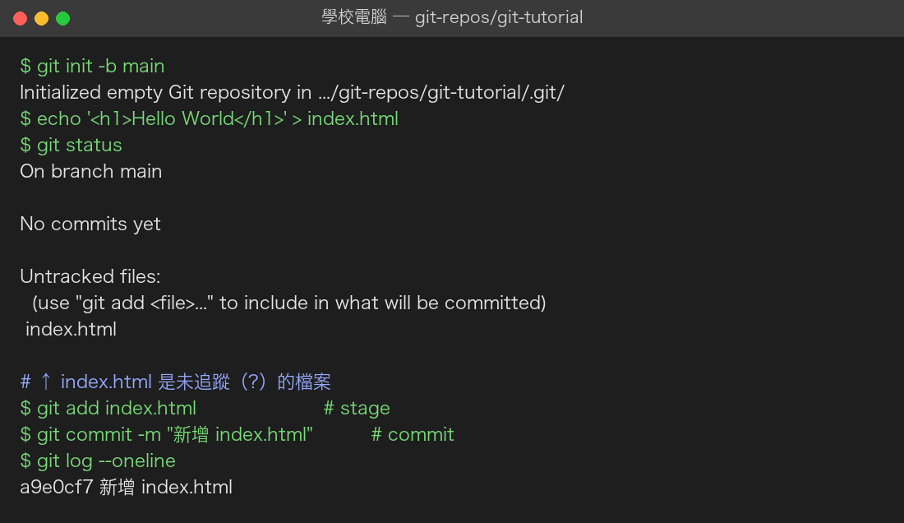

### 2. 小量改進：修改內容（p.46–50）
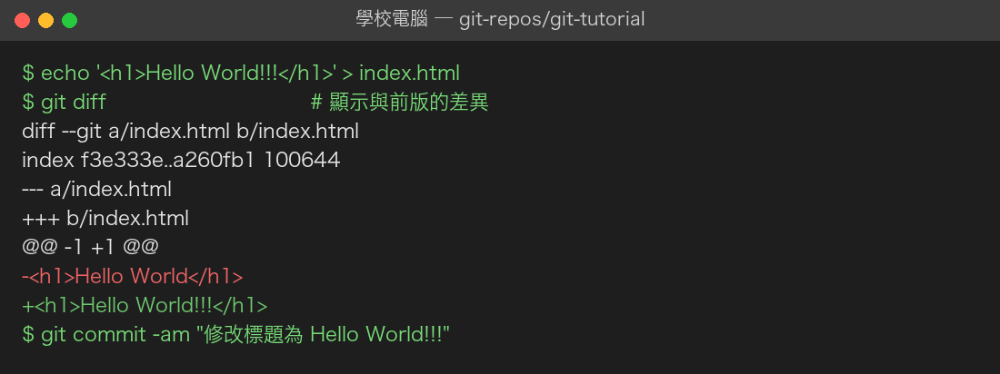

### 3. 小量改進：新增檔案 git-logo.png（p.51–57）
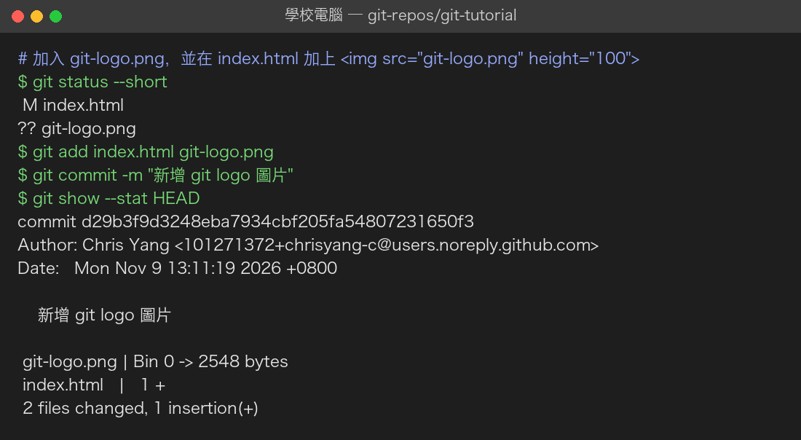

### 4. 交付後後悔了：reset（p.58–61）
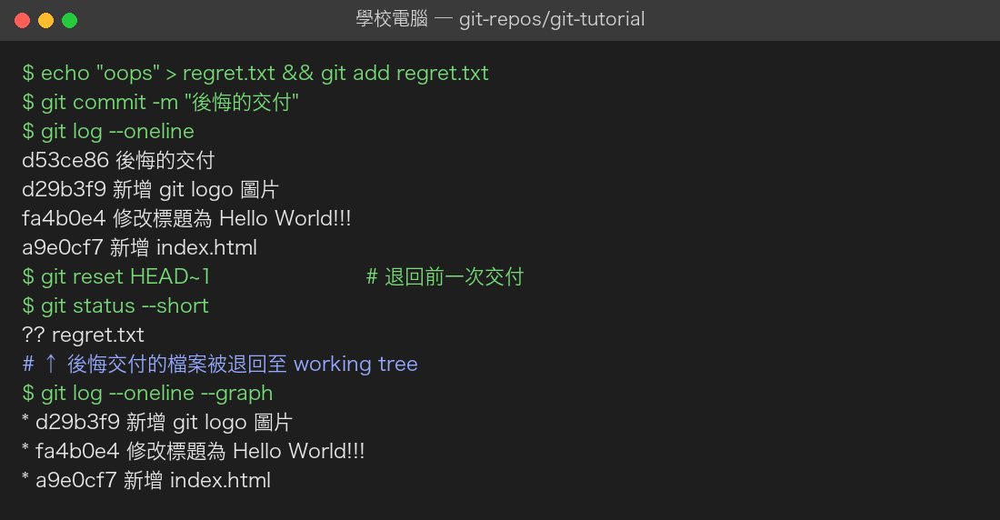

### 5. 設定遠端儲存庫並 push（p.77–95）
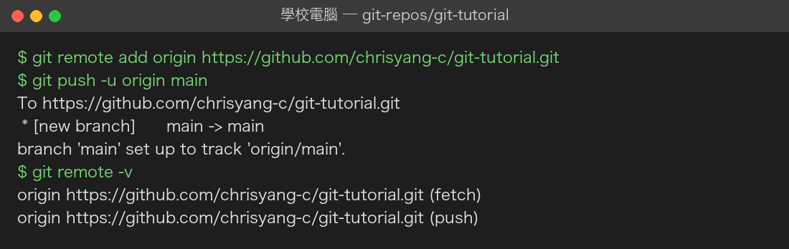
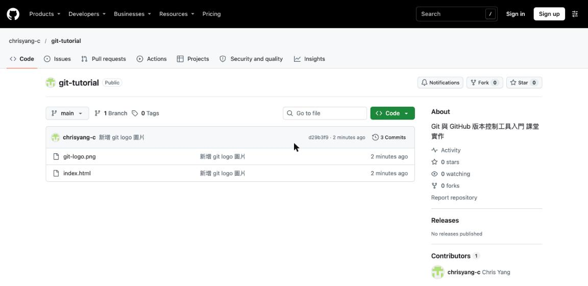
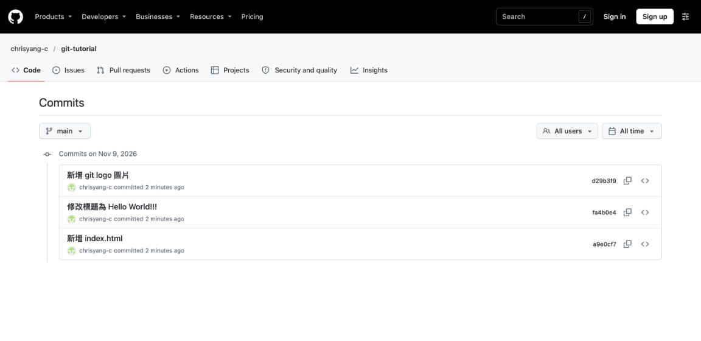

### 6. 在家 clone、修改、push（p.97–109）
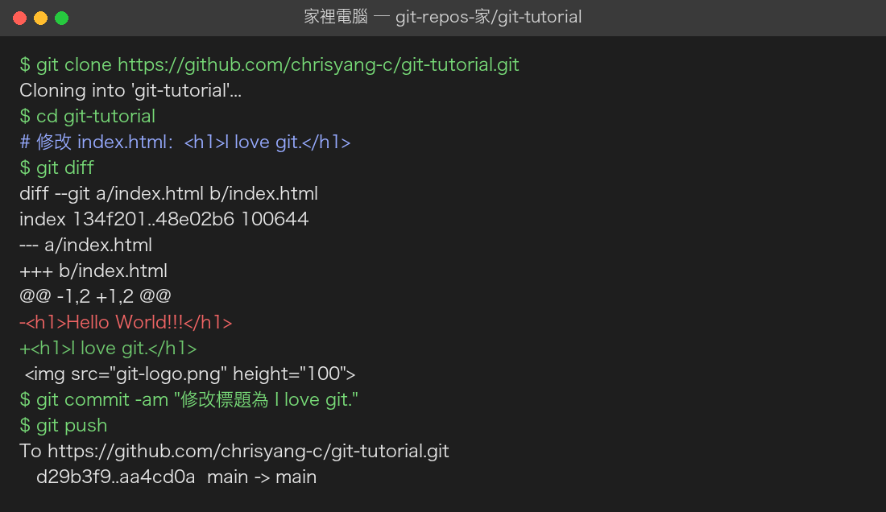

### 7. 回到學校 pull 同步（p.110–114）
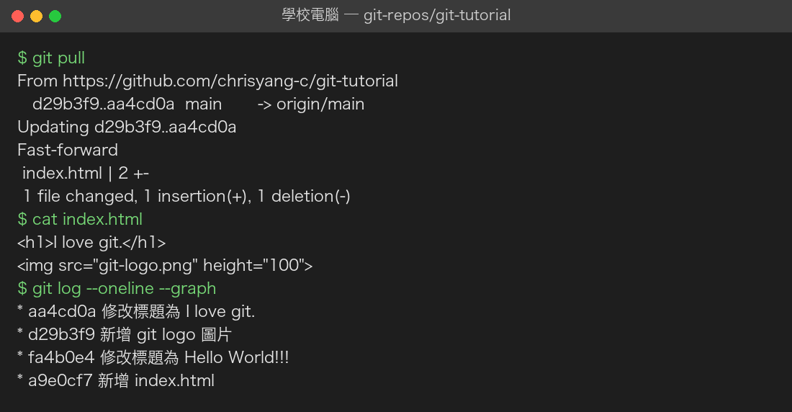

### 8. 檢視遠端儲存庫最終狀態（p.93–94、p.109）
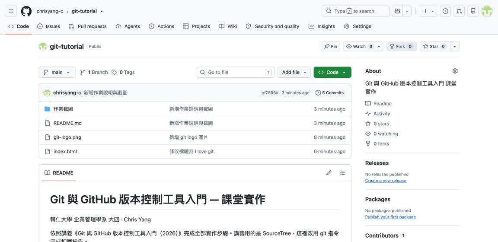
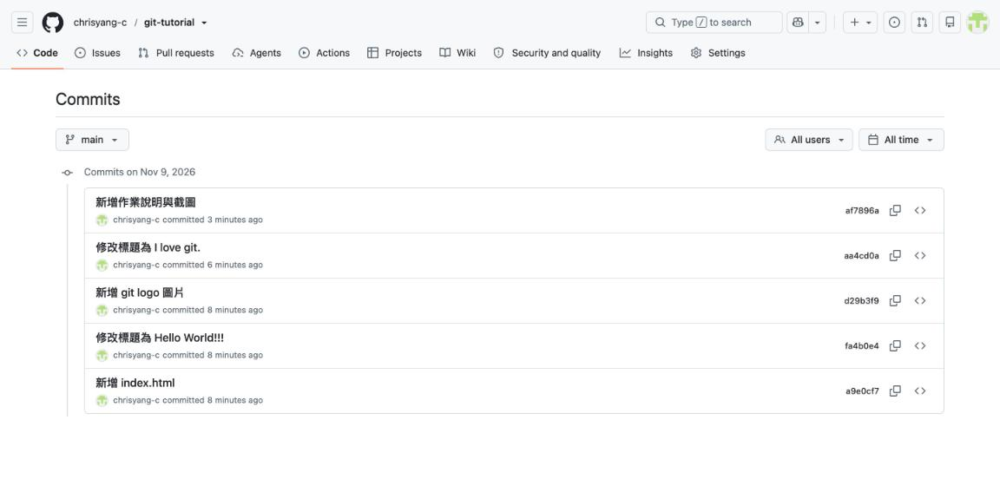
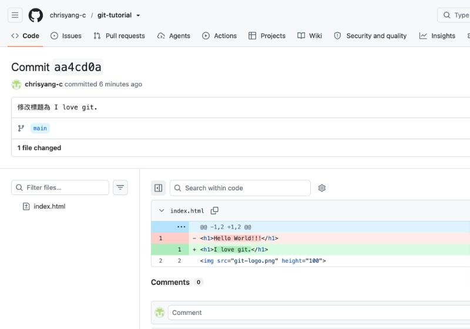

### 9. GitHub Profile（p.67–76）
個人頁面：<https://github.com/chrisyang-c>

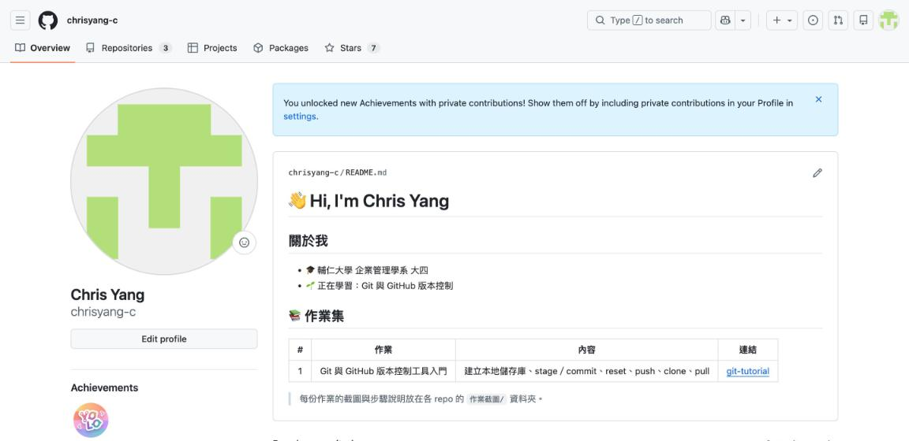
